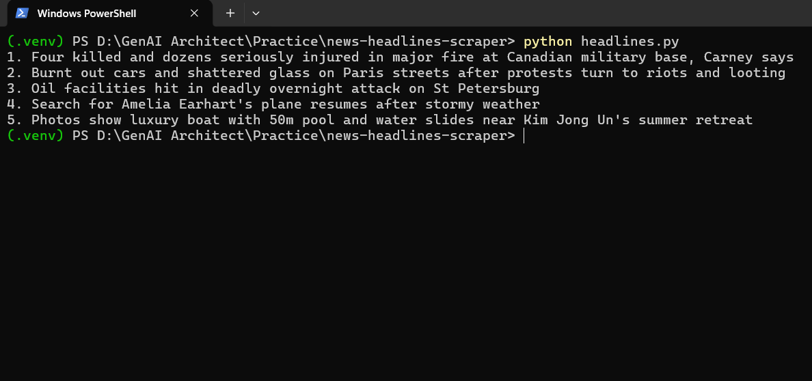

# News Headlines Scraper

A small Python script that fetches BBC News and prints up to five unique, non-empty headlines in the terminal using `requests` and BeautifulSoup.

## Demo



## Features

- Sends a browser-like `User-Agent` header.
- Checks the HTTP response status before parsing the HTML.
- Uses the inspected selector `h2[data-testid="card-headline"]`.
- Trims whitespace and skips empty or duplicate headlines.
- Prints available headlines with numbering from 1 to 5.
- Handles request failures and pages with fewer than five matching headlines.

## Prerequisites

- Python 3.10 or later
- Internet access

## Setup on Windows PowerShell

From the project directory:

```powershell
py -m venv .venv
.venv\Scripts\Activate.ps1
python -m pip install -r requirements.txt
```

If PowerShell prevents virtual-environment activation, you can run the script using the environment's Python executable directly:

```powershell
.venv\Scripts\python.exe -m pip install -r requirements.txt
.venv\Scripts\python.exe headlines.py
```

## Run

With `.venv` activated:

```powershell
python headlines.py
```

The script prints up to five unique headlines, one per line. If the page provides fewer than five, it prints the available headlines and a warning. Network errors and HTTP errors are reported without a traceback.

## How it works

1. Requests `https://www.bbc.com/news` with a browser-like `User-Agent` and a timeout.
2. Checks the HTTP status using `raise_for_status()` before parsing.
3. Parses the response HTML with BeautifulSoup.
4. Selects headline elements using `h2[data-testid="card-headline"]`, a selector verified in the browser at the time this project was prepared.
5. Normalizes whitespace, skips empty and duplicate entries, and stops after five unique headlines.

## Limitations

BBC may change its HTML structure, block automated requests, or serve content differently by location or over time. If no headlines are found, inspect the current page and update the selector. The script does not use a browser automation tool to execute JavaScript.

## Project files

- `headlines.py` — scraper implementation
- `requirements.txt` — Python dependencies
- `.gitignore` — excludes virtual environments and local/generated files
